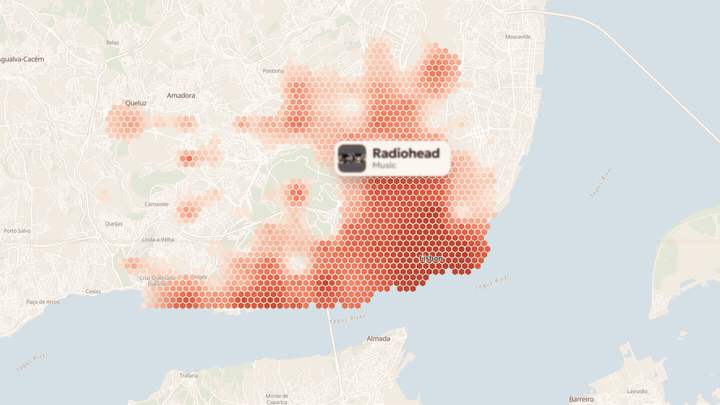
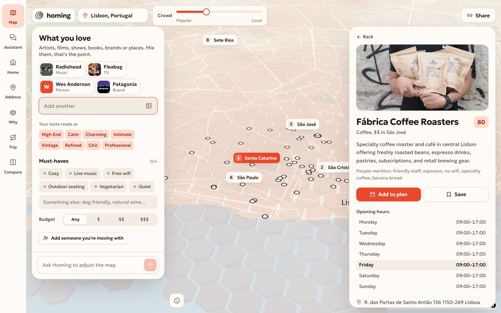
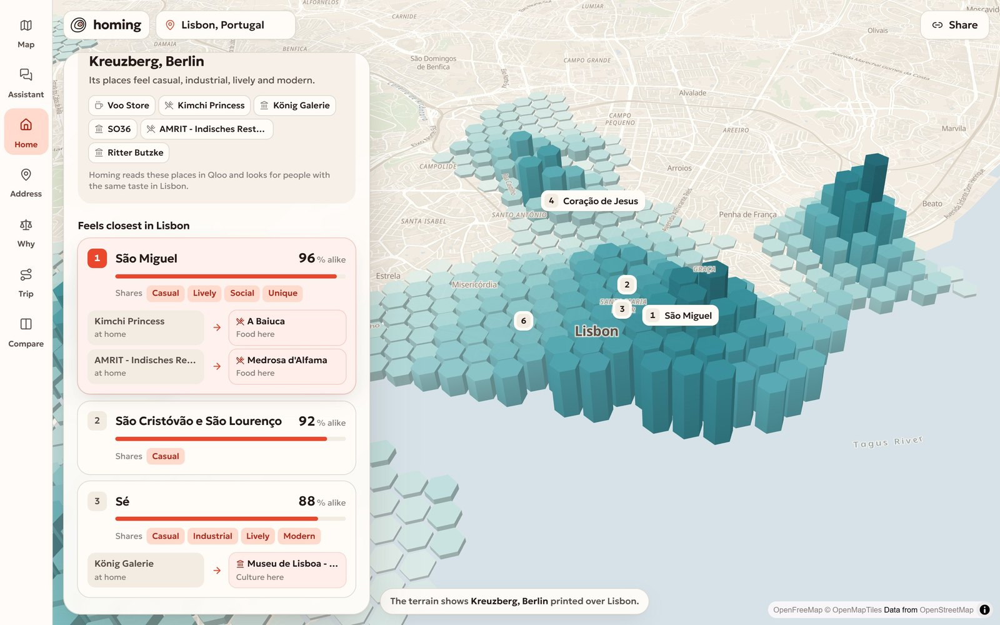
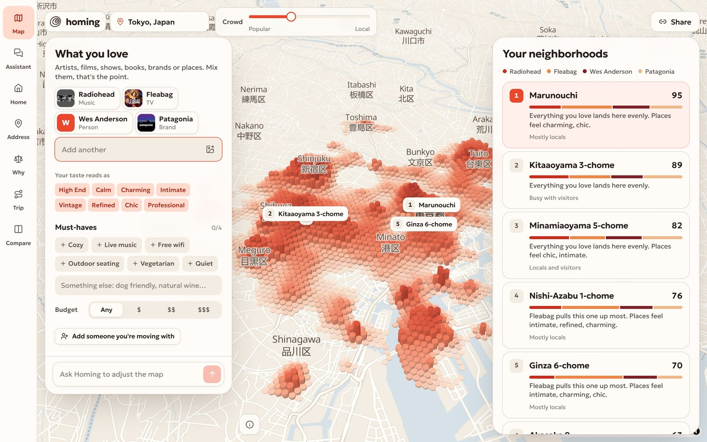
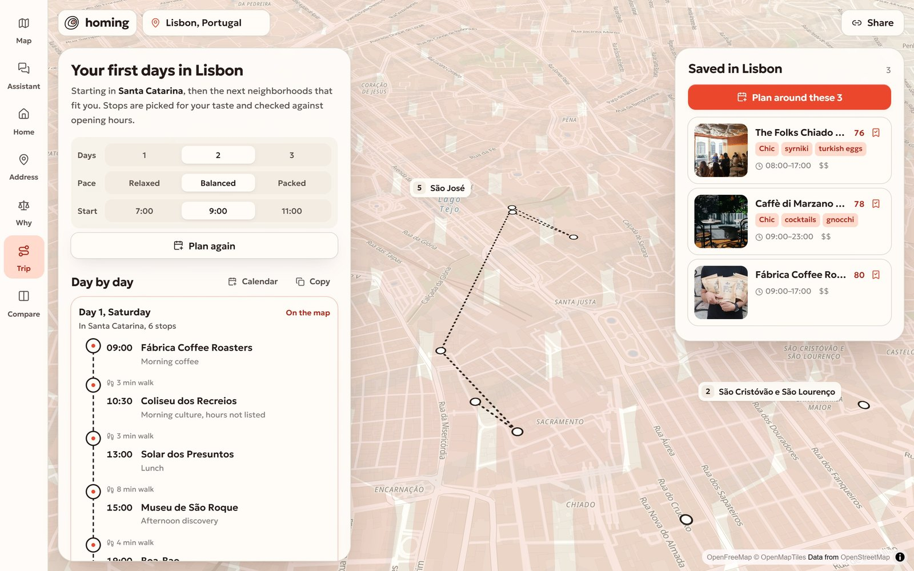
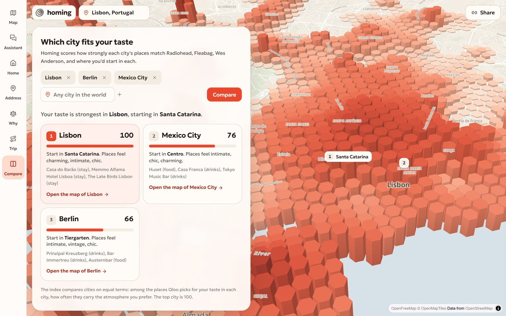
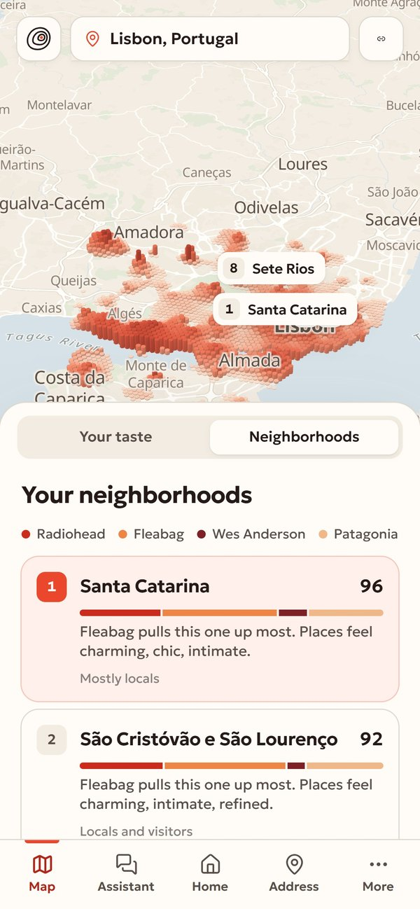
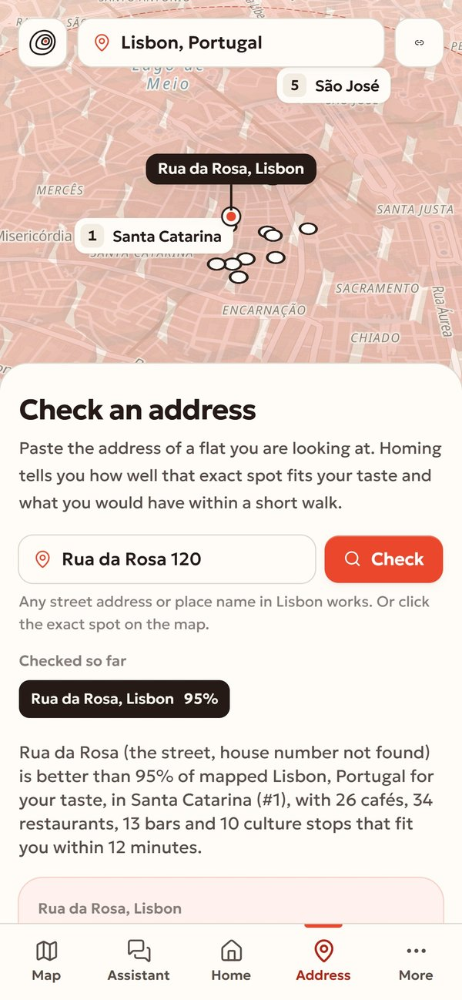

<p align="center">
  
</p>

<h1 align="center">Homing</h1>

<p align="center"><strong>Find your part of any city.</strong><br/>
Tell Homing a few things you love. It maps where people with your taste gather in a city, picks the neighborhood that fits you and plans your first days there.</p>

<p align="center">
  <a href="https://homing-taste.vercel.app/#demo">Watch the 62-second film</a> &nbsp;&nbsp;
  <a href="https://homing-taste.vercel.app"><strong>Try it live</strong></a> &nbsp;&nbsp;
  <a href="#how-it-works">How it works</a> &nbsp;&nbsp;
  <a href="#architecture">Architecture</a> &nbsp;&nbsp;
  <a href="#run-it-locally">Run it locally</a>
</p>

<p align="center"></p>


## The problem

When you move to a new city, or stay somewhere for a month, the neighborhood decides what your days feel like. You have to pick it before you know the city. Guides and chat assistants answer for an average visitor: the same five districts, described with the same stereotypes. Nobody can tell you where the people who love what *you* love actually spend their time.

## What Homing does

1. **You name what you love**, from any domain: artists, films, shows, books, brands, places. Type them, or drop a screenshot of a playlist, watchlist or bookshelf. A genre works too: "jazz" is carried by its best-known artists, and the chip says so.
2. **Any city in the world.** Pick from the list or type any town; Homing finds it and builds the map there.
3. **The city turns into a taste terrain.** Columns rise where audiences with your taste over-index. Hover any column to see which of your loves drives it and whether it's busy with visitors or mostly locals.
4. **Neighborhoods are ranked with reasons:** which of your loves pulls each one up, and what its places feel like (cozy, vintage, live music).
5. **Say what a place must have** (cozy, live music, free wifi, outdoor seating, or anything else Qloo tags) and set a budget. The map and the picks follow.
6. **Open a neighborhood** to get cafés, food, bars, culture and stays that match you, each with the tags that make it a match. Open any place for its hours, address and website, save it to a shortlist, or put it into the plan. Click the terrain to open the nearest neighborhood.
7. **Feels like home.** Name a neighborhood you lived in, like Kreuzberg in Berlin. Homing reads the places that define it in Qloo, uses them as taste signals over the new city and ranks its neighborhoods by how alike they are, with the tags they share and twin places: Kimchi Princess in Kreuzberg, A Baiuca in Lisbon. You can mix in what you love, or keep only the old neighborhood.
8. **Check an address.** Type the address of a flat you are looking at, or click the exact spot on the map. Homing tells you how it ranks against the rest of the city for your taste (Rua da Rosa: better than 95% of mapped Lisbon), which neighborhood it is in, which of your loves lift it, and what fits you within a 12 minute walk, including what's open late.
9. **What decides.** For the top neighborhoods, Homing ranks the city again without each of your loves and shows where each one would land. You see whether the pick is robust or which love it is built on.
10. **Plan my first days** builds a 1 to 3 day route around real opening hours and walking distance, at your pace (relaxed, balanced, packed) and from the hour you get up. Swap any stop you don't like, plan around your shortlist, then export it to your calendar or copy it.
11. **Compare.** Two neighborhoods side by side, or the same taste scored across up to five cities, with where you'd start in each.
12. **Talk to it.** The assistant is a full screen: a conversation with streamed answers, a "What I did" list of the steps it took, and result cards that open on the map. "Less touristy." "I work from cafés." "Add my partner: Succession and Peggy Gou." "I used to live in Kreuzberg, Berlin." "How is Rua da Rosa 120 for me?" It turns that into real changes on the map or a real answer from Qloo data, and tells you what changed.
13. **Moving with someone?** Add what they love. The map prints in two inks, and neighborhoods are ranked so the less happy person is as happy as possible.
14. **Share** the exact map with a link. Everything is in the URL, so it recomputes the same for whoever opens it.

**Every screen sits on one map.** Map, Assistant, Feels like home, Check an address, What decides, Trip and Compare are screens around the same live map, with a rail on the desktop and a tab bar on the phone. The map, its terrain and the camera stay in place when you switch, and each screen draws its own answer on it: another neighborhood's taste in teal, a pin with a walking ring, the route of a day.

Feels like home, Check an address and What decides are composed by Homing from real Qloo calls. Qloo does not answer these questions by itself, and none of them works without Qloo ([how](#why-it-only-works-with-qloo)).

| Your taste over Lisbon | A place, opened | Two people, two inks |
| --- | --- | --- |
|  |  |  |

**The assistant at work.** "I used to live in Kreuzberg, Berlin" comes back as a card with São Miguel, 96% alike, and Kimchi Princess paired with A Baiuca. "How is Rua da Rosa 120 for me?" comes back as better than 95% of mapped Lisbon, in Santa Catarina. Each card opens its screen on the map.

<p align="center"></p>

| Feels like home: Kreuzberg printed over Lisbon | Check an address: Rua da Rosa | What decides |
| --- | --- | --- |
|  |  |  |

| Any city: Tokyo for the same taste | Your first days | Which city fits you |
| --- | --- | --- |
|  |  |  |

<p align="center">&nbsp;&nbsp;&nbsp;</p>

## Why it only works with Qloo

Take Qloo out and there is nothing left to show. Every step uses Qloo's taste graph, and the three newest features are compositions of Qloo calls that Qloo does not offer as one answer:

| Step | Qloo call | What Homing does with it |
| --- | --- | --- |
| Understand the input | `GET /search` | Matches "Fleabag" to the show entity (not the book), with its audience. Ambiguous matches are offered as alternatives. |
| Genres | `GET /v2/tags` with `filter.tag.types=urn:tag:genre:music`, then artist insights with `signal.interests.tags` | "jazz" or "techno" has no entity of its own, so the genre's leading artists stand in for it. |
| City centre | `GET /v2/insights?filter.type=urn:entity:place&filter.location.query=…` | The median of a city's most popular places, for any city name in any language. |
| Taste field | `GET /v2/insights?filter.type=urn:heatmap` with `filter.location=POINT(…)`, a 15 km radius and `signal.interests.entities`, one call per love plus a combined one | Re-ranks cells inside the city, weighs each love by how much you care, mixes in refinement tags and applies the crowd dial using per-cell popularity. |
| Refinements | `GET /v2/tags`, then heatmaps with `signal.interests.tags` | "Cozy", "live music", "free wifi" become extra layers on the field. |
| Neighborhoods | `GET /v2/insights?filter.type=urn:entity:place` across the city | Names and centres of neighborhoods come from the places inside them; cells are assigned to them and scored. |
| Taste fingerprint | `GET /v2/insights?filter.type=urn:tag` with `filter.tag.types` for ambience, decor and place genres | Describes what you look for in a place, and explains neighborhoods and places through it. |
| Places | place insights with `filter.location=POINT(...)`, `radius` and category tags | Per-category picks that fit you, with opening hours, price level, address and images. |
| Compare cities | place insights per city, matched against your taste fingerprint | The share of your preferred atmosphere among the places Qloo picks for you in each city, on equal terms. |
| Two people | everything above for both, plus shared and diverging tags | Fairness ranking: max of the minimum satisfaction. |
| Feels like home | place insights within 1.2 km of the old neighborhood; then heatmaps over the new city with those places in `signal.interests.entities`; then place insights within 900 m of each match, signalled by the same places | The places that define Kreuzberg stand in for a taste. Their field over Lisbon is ranked like your own, the shared tags come from Qloo's ambience and decor tags, and twins are same-category places inside each match. |
| Check an address | your taste field (the heatmaps above), plus place insights within 1 km of the point by category | The field is interpolated at the exact point the way the map draws it, ranked against every mapped cell of the city, and the places within a 12 minute walk are counted, with what's open late. |
| What decides | the full ranking again without each love, from the per-love heatmaps | A real leave-one-out ranking for every love: the rank each top neighborhood would have, and whether the pick is robust or rests on one love. |

A language model alone can name famous districts. It cannot tell you that, for a person who loves Radiohead, Fleabag and Wes Anderson, the strongest concentration of similar people in Lisbon sits in one specific set of streets and not in the one every guide recommends. Homing can, because Qloo knows where those audiences are.

## How it works

```
 loves (text, chips, screenshot)
        │  Gemini 3.8 Flash extracts names        Qloo /search resolves entities
        ▼
 ExploreState  ──►  taste field  ──►  neighborhoods  ──►  places  ──►  plan
 (in the URL)      Qloo heatmaps     Qloo places +       Qloo places   opening hours +
                   per love,         assignment,         by category   walking distance
                   weights, dial     fingerprint tags
        ▲
        │  the agent edits the state through tools (search, tags, apply changes, get ranking)
        │  and answers through the features (feels like home, check an address, what decides)
 "less touristy, add my partner…"
```

**The field.** Homing finds the city's centre from its most popular places and asks Qloo for the heatmap in a 15 km circle around it. Asked by city name, Qloo picks a different grid size per place (Tokyo comes back as 5 km cells spread over the whole prefecture); around a point it always answers with ~150 m geohash-7 cells, which Homing folds into ~1.2 km geohash-6 cells. Each cell has an affinity, the affinity of each domain, and popularity. Homing keeps the city, converts each series to a percentile inside it, combines your loves by weight, blends refinement layers, and applies the crowd dial:

$$ s = \frac{\sum_i w_i \, a_i}{\sum_i w_i}, \qquad s' = (1-r)\,s + r\,\overline{a_{tags}}, \qquad final = s' \cdot (1 - 0.7\, d\, p) $$

where $a_i$ is the percentile of love $i$ in the cell, $w_i$ your weight, $r = 0.35$, $d$ the crowd dial and $p$ the cell's popularity.

**The terrain.** Cells are interpolated onto a 130 m hex grid with inverse distance weighting and drawn as extruded columns in MapLibre. Two people are drawn with two inks that overprint where both are strong.

**Neighborhoods** get the mean of their top cells and the affinity of their places. With two people the ranking maximises $\min(you, them)$.

**The plan** is a chain of stops from the hour you start: coffee, culture, lunch (never before 12:30), an afternoon stop, dinner (never before 19:00) and drinks, with fewer or more daytime stops depending on pace. Each candidate is scored by affinity minus a walking penalty, places closed at that hour or above your budget are skipped, and no place repeats. A swapped stop is excluded and the rest of the day is kept where it can be; places you asked for are reserved first.

**Feels like home** finds the old neighborhood with the geocoder, asks Qloo for up to 30 popular places within 1.2 km and keeps up to eight, covering coffee, food, drinks and culture where it can. Those places become the signals for the same field and ranking as your own taste; with "Mix in what I love" your own loves are blended in at half the weight of the old neighborhood. Each match gets the tags it shares with the old neighborhood and twin places of the same category.

**Check an address** interpolates the field at the point exactly as the map does (the nearest cells, inverse squared distance), counts how many mapped cells of the city score lower, and asks Qloo for places within 1 km, keeping those within a 12 minute walk.

**What decides** runs the real ranking once per love with that love removed (at most two variants at a time, reusing the cached per-love heatmaps) and compares the ranks.

**The agent** runs on OpenRouter (`google/gemini-3.8-flash`) with tools that call the same engine. It never invents places: it can only change the state, look things up in Qloo, read the resulting ranking and run the three features above. Each tool call is streamed to the UI as it happens, and results come back as cards.

## Architecture

Homing is one Next.js app. The browser holds the state and draws the map; route handlers on Vercel run the taste engine and the agent; Qloo is the only source of taste data.

```
 Browser                                   Vercel (Next.js route handlers)                 External
 ───────                                   ───────────────────────────────                 ────────
 Landing ──── GET /api/landing ──────────► scenes: field + ranking + city compare ─┐
   loader waits for every map              (one answer, CDN-cached for a day)      │
                                                                                    │
 Explore screens (/explore/*, one map, state in URL)                               │
   ├─ POST /api/field ─────────────────► engine/field.ts       heatmaps per love ──┤
   ├─ POST /api/neighborhoods ─────────► engine/neighborhoods  places → areas      │
   ├─ POST /api/places ────────────────► engine/places.ts      picks per category  ├──► Qloo Taste AI
   ├─ POST /api/plan ──────────────────► engine/plan.ts        hours + walking     │    /search, /v2/insights,
   ├─ POST /api/cities ────────────────► engine/cities.ts      same taste, 5 cities│    /v2/tags
   ├─ POST /api/fingerprint ───────────► engine/fingerprint    taste tags          │
   ├─ POST /api/home ──────────────────► engine/home.ts        places as signals   │
   ├─ POST /api/spot ──────────────────► engine/spot.ts        field at a point    │
   ├─ POST /api/decides ───────────────► engine/decides.ts     leave-one-out ranks │
   ├─ GET  /api/search, /api/tags ─────► qloo/search.ts        entities, genres ───┘
   ├─ GET  /api/localities ────────────► geo/geocode.ts: Photon + Open-Meteo (cities, neighborhoods, addresses)
   ├─ POST /api/intake ────────────────► agent/intake.ts ──────────────────────────► OpenRouter
   └─ POST /api/agent  (SSE stream) ───► agent/runner.ts → tools → engine ─────────► (Gemini 3.8 Flash)
 MapLibre GL ◄── vector tiles ───────────────────────────────────────────────────── OpenFreeMap
```

### Repository map

| Path | What lives there |
| --- | --- |
| `src/shared/contracts.ts` | Zod schemas for everything that crosses the wire: `ExploreState`, `TasteField`, `Neighborhood`, `Place`, `Itinerary`, `CityScore`, `StatePatch`, `AgentEvent`. Server and client import the same types. |
| `src/shared/patches.ts` | `applyPatches`: the only way state changes, for the UI and the agent alike. Enforces limits (8 loves, 4 refinements) and skips invalid ops. |
| `src/lib/state.ts` | The whole map state as compact base64url in `?s=`. A shared link recomputes the same map. |
| `src/server/qloo/` | `client.ts` (cache, concurrency, retries, response trimming) and `search.ts` (entity search, genre stand-ins, tag search). |
| `src/server/engine/` | The taste engine: city centre, field, neighborhoods, fingerprint, places, plan, city comparison, and the compositions `home.ts`, `spot.ts`, `decides.ts`. Pure functions over Qloo responses. |
| `src/server/geo/geocode.ts` | The shared geocoder: Photon and Open-Meteo with a city bias, distance and name checks, house-number handling, reverse labels for clicked points, and a bounded cache. |
| `src/server/agent/` | LLM client, fast planner, tool loop, grounded final reply, screenshot intake. |
| `src/app/api/*` | Thin route handlers: validate with Zod, call the engine, map errors to HTTP codes. |
| `src/app/explore/` | `layout.tsx` holds the store and the one map; each screen (`assistant`, `home`, `address`, `why`, `trip`, `compare`) is a route that renders only its own panels. |
| `src/components/map/` | `TerrainMap` (MapLibre), `hexgrid.ts` (interpolation onto hexes, colour ramps, two inks, the teal ink of a borrowed field), the paper map style. |
| `src/components/explore/` | The shell (rail, tab bar, top bar), the store, the Map, Assistant, Trip and Compare screens, panels, chips, place drawer. |
| `src/components/screens/` | Feels like home, Check an address and What decides, their result cards, and the provider that keeps each result tied to its city. |
| `src/components/landing/` | The landing page, its data provider and loader. |
| `tests/` | Vitest unit and route tests, live Qloo tests, a Playwright end-to-end run against production. |

### One map, end to end

1. The explore page decodes `?s=` into an `ExploreState` (Zod-validated; a broken link falls back to an empty state).
2. The store asks `/api/field`. The engine finds the city centre (the median of Qloo's most popular places there), then requests one heatmap per love plus a combined one around that point. Geohash-7 cells are folded to geohash-6, every series becomes a percentile inside the city, and the series are weighted, blended with refinement layers and discounted by popularity according to the crowd dial.
3. `/api/neighborhoods` reuses the field: Qloo places in the area name the neighborhoods, cells are assigned to them, and each gets a score, drivers (which love lifts it) and matched taste tags.
4. The client interpolates cells onto a 130 m hex grid and animates the extrusion heights through a MapLibre paint expression, so a change re-forms the same columns instead of redrawing them.
5. Opening a neighborhood calls `/api/places` (per-category Qloo place insights around its centre); `/api/plan` turns them into a day-by-day route.
6. The explore layout keeps one `TerrainMap` mounted while you move between screens. A screen can lay a map overlay over it: a borrowed field (drawn in teal so it never reads as your own taste), its own neighborhoods, places, a pin, a ring, a camera focus, or a click handler. The overlay belongs to the screen that set it and disappears when you leave.

Every request that changes the map is guarded on the client by a sequence number, so a slow answer for an old city or an old plan never lands on a new one. URL updates use `replaceState`, except opening a neighborhood, which pushes a history entry so the browser Back button returns to the ranking.

### Talking to Qloo

`src/server/qloo/client.ts` is the single door to Qloo:

- **Caching.** Responses are cached in process for 7 days and through Next's fetch cache (`revalidate: 604800`). Identical requests in flight are shared, not repeated.
- **Back-pressure.** At most 4 Qloo requests run at once per instance; the rest wait in a queue.
- **Resilience.** A 9 s timeout per call; 429 is retried twice with jittered backoff, 5xx and network errors once. Failures surface as typed errors (`quota`, `qloo_unavailable`, `not_found`) that the UI explains in plain words.
- **Trimming.** Only the fields the engine reads are kept. Qloo data is never written to this repository; test fixtures are generated locally and ignored by git.

### The agent

`POST /api/agent` streams Server-Sent Events: `trace` (a tool call and what it did), `patch` (state changes), `card` (a result to show: ranking, home, spot or decides), `delta` (reply text), then `done` or `error`.

- **Fast path.** One JSON-mode call turns the request into a small change plan: patches, names to look up, place preferences. The server runs all lookups against Qloo in parallel, validates the patches, applies them and re-ranks. Most requests finish here in a few seconds.
- **Tool loop.** Anything the planner can't express falls back to a tool loop over `search_entities`, `search_place_tags`, `apply_changes`, `get_ranking`, `explain_neighborhood`, `find_home`, `check_address`, `what_decides` and `get_places`, with at most 8 tool decisions.
- **Cards.** The three features are read-only for the agent: they never change your loves. Their replies are written from the returned result, so a name or a number in the text is the one on the card. After a change to the map, a fresh ranking card follows the patch.
- **Grounding.** The agent can change state only through patches and can read only what Qloo returns. The final reply is written from the actual ranking before and after the change, so it can't invent a neighborhood or a place.
- **Screenshot intake** (`/api/intake`) sends a validated PNG, JPEG or WebP (up to 4 MB) to the model, which extracts names; Qloo resolves them like typed chips.

### The landing page

The landing shows four live maps. `GET /api/landing` builds all of them on the server in one go (entities, fields, rankings and a five-city comparison) and returns one response that the CDN keeps for a day and serves stale while it refreshes. The page preloads that response, the map style and the tile host before hydration. A loader stays up until every map reports that its terrain is drawn and its tiles are in, then opens like a curtain.

### Technology

| Technology | Why |
| --- | --- |
| **Next.js 16** (App Router, Turbopack) | Pages and API in one deployable; route handlers keep the Qloo and OpenRouter keys on the server. |
| **React 19** | A context store for the workspace; concurrent rendering keeps the map smooth while panels update. |
| **TypeScript + Zod 4** | One set of schemas validates requests, Qloo-derived data, agent patches and the URL state. |
| **MapLibre GL 5** | Open-source WebGL maps: `fill-extrusion` for the terrain, data-driven paint expressions for animation and two inks. |
| **OpenFreeMap** | Free vector tiles, restyled into a quiet paper atlas so the terrain reads first. |
| **Qloo Taste AI** | Entities, heatmaps, places and tags: the data the whole product is built on. |
| **OpenRouter, Gemini 3.8 Flash** | Fast tool calling and JSON mode for the agent; vision for screenshots. |
| **Photon, Open-Meteo geocoding** | City suggestions for any place in the world, queried in parallel so one slow provider doesn't block typing; neighborhoods and addresses for Feels like home and Check an address. |
| **Motion** | Spring-based UI motion: chips, panels, the loader. |
| **Tailwind CSS 4** | Design tokens in OKLCH, one paper palette for the map and the UI. |
| **Vitest** | Engine, agent, patch and route tests; live Qloo tests behind `QLOO_LIVE=1`. |
| **Playwright** | 16 end-to-end scenarios against production (`node tests/e2e/run.mjs`). |
| **Vercel** | Hosting, the function runtime and the CDN cache for the landing data. |

## Run it locally

```bash
git clone https://github.com/DarinaX2005X/qloo-hackathon.git
cd qloo-hackathon
npm install
cp .env.example .env.local   # add your keys
npm run dev
```

Open http://localhost:3000.

| Variable | What it is |
| --- | --- |
| `QLOO_API_KEY` | Qloo Taste AI key (hackathon server) |
| `QLOO_API_URL` | `https://hackathon.api.qloo.com` |
| `OPENROUTER_API_KEY` | OpenRouter key for the agent and screenshot reading |
| `LLM_MODEL` | `google/gemini-3.8-flash` |

`npm test` runs the engine, agent and state tests. Tests that call Qloo live run only with `QLOO_LIVE=1`.

## Data handling

Qloo responses are cached on the server and never stored in this repository. Keys live in `.env.local` and in the Vercel project settings.

## Limits

- Homing looks at the 15 km around a city's centre. Small towns can have thin data, and Homing says so.
- Comparing cities Homing hasn't mapped yet takes a few seconds per city; after that it is cached.
- Some domains, like video games, have no geographic signal. They still shape your taste fingerprint and place picks.
- Opening hours come from Qloo and can be missing for some places; the plan marks those.
- A typed address is as precise as the geocoder. When it has no house number for a street (Rua da Rosa 120 is one), the check runs at street level and the answer says the house number was not found. Clicking the exact spot on the map is always exact.
- Feels like home works best for neighborhoods with plenty of places in Qloo; a very quiet area has too few to stand in for a taste, and Homing says so.
- What decides ranks the city once per love, so the first answer for a new taste takes several seconds; after that the per-love heatmaps are cached.

## License

[MIT](LICENSE)
