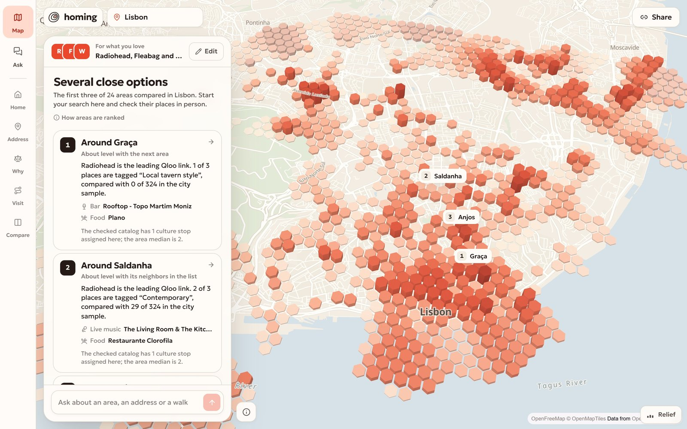
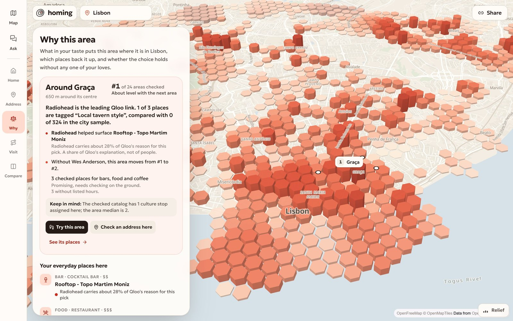
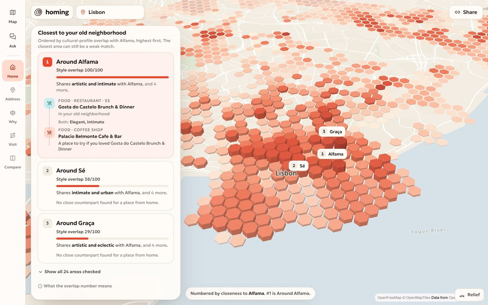
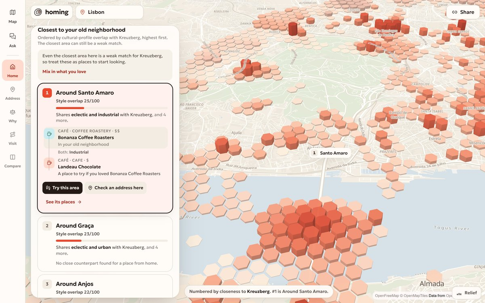
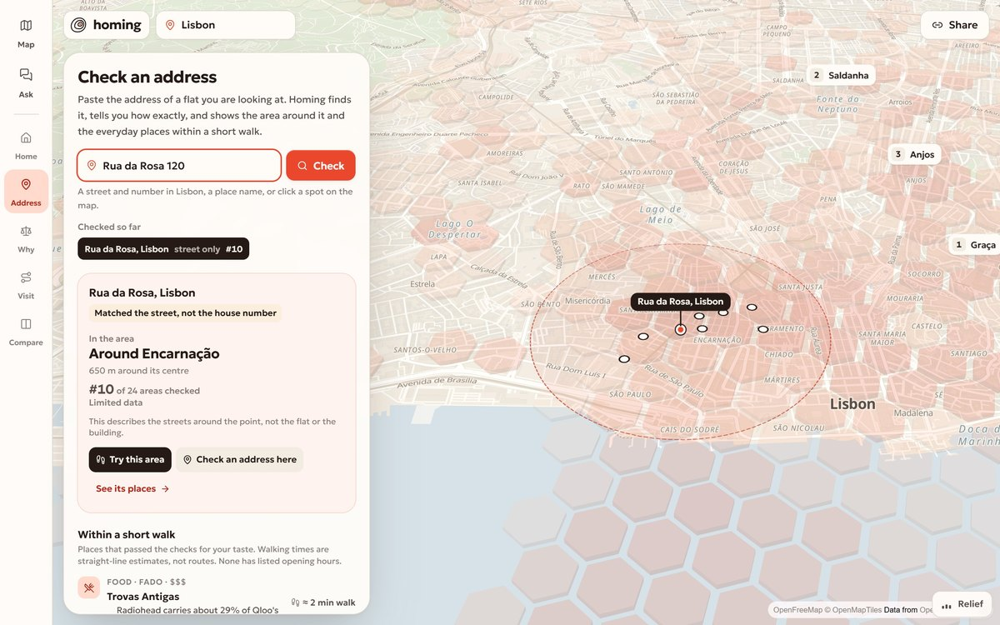
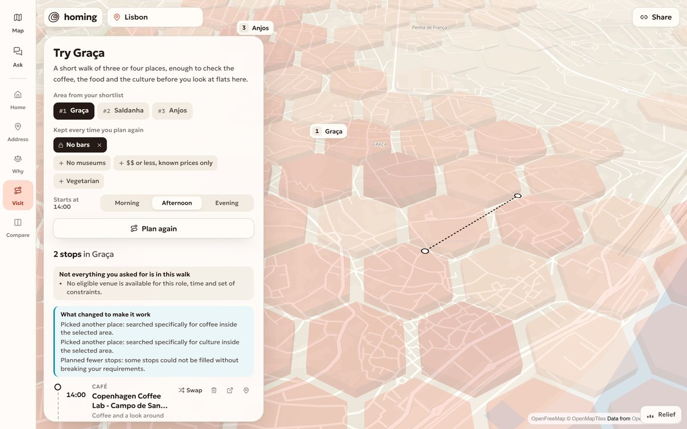
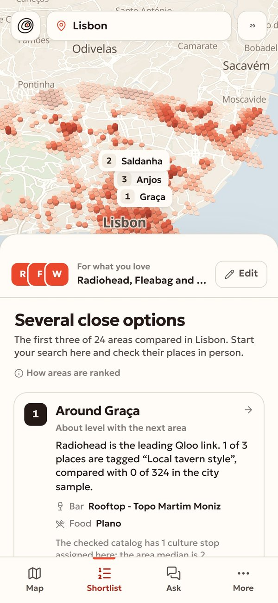
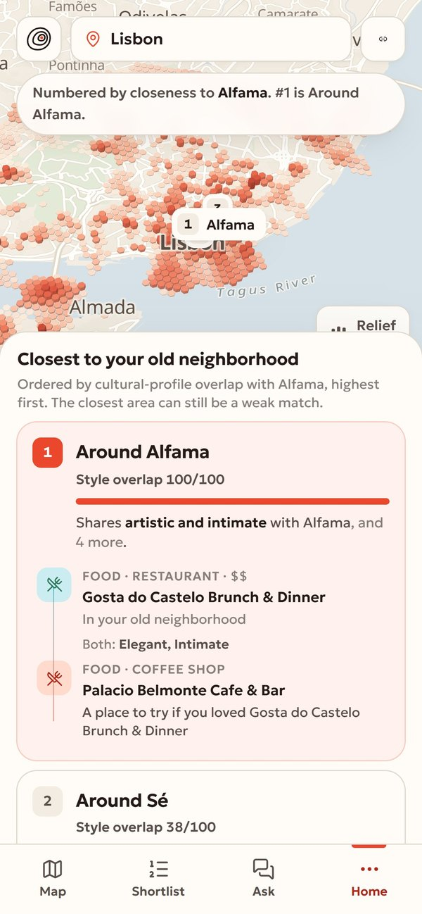
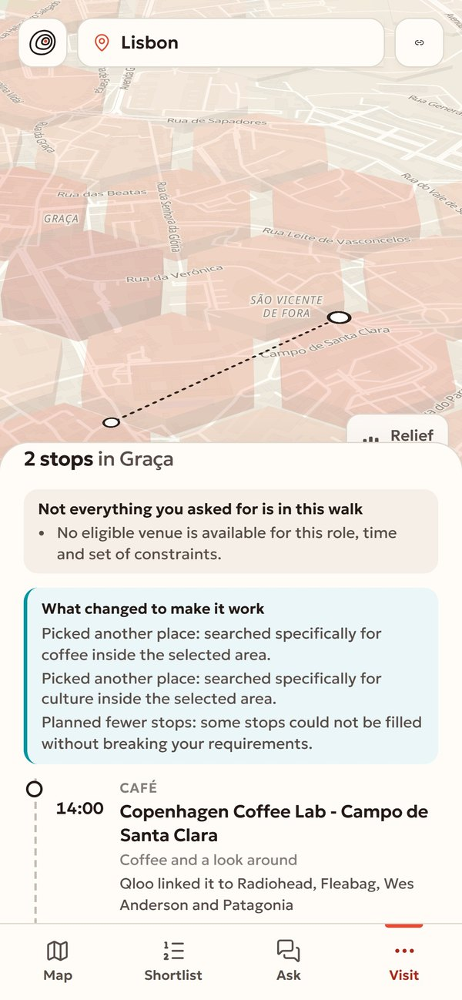

<p align="center">
  
</p>

<h1 align="center">Homing</h1>

<p align="center"><strong>Find a neighborhood that feels like you in a new city.</strong><br/>
You are moving and you don't know the city yet. Bring the things you love, or the neighborhood you loved living in. Homing suggests three areas to start your home search, shows why, and gives you real places to check in each.</p>

<p align="center">
  <a href="https://homing-taste.vercel.app"><strong>Try it live</strong></a> &nbsp;&nbsp;
  <a href="https://homing-taste.vercel.app/#demo">Watch the film</a> &nbsp;&nbsp;
  <a href="#one-run-start-to-finish">One run, start to finish</a> &nbsp;&nbsp;
  <a href="#where-qloo-comes-in">Where Qloo comes in</a> &nbsp;&nbsp;
  <a href="#run-it-locally">Run it locally</a>
</p>



## Who it is for

Someone moving to a new city for months or longer, alone or with a partner, who has to decide where to look at flats before they know the place. Rental sites show flats and prices. They don't show whether the streets around a flat will feel like your kind of place. Homing answers that part: **where to start looking, and what to check when you get there.**

It does not judge the flat, the rent, safety, schools or transport. It says so in the product.

**Try your own input:** open [homing-taste.vercel.app](https://homing-taste.vercel.app), type a few things you love (artists, shows, films, books, brands, places) or switch to *Where I lived* and name your old neighborhood, pick the city you are moving to, and press *Find my areas*.

## One run, start to finish

All numbers below come from one live run of the released code with live Qloo data (Lisbon, with Radiohead, Fleabag, Wes Anderson and Patagonia), captured 30 October 2026.

**1. A shortlist of three.** Homing checks the same 24 areas of Lisbon for everyone, each around a fixed centre. The rank reads the city within about 1.6 km of that centre; the places on the card come from a walkable circle of about 650 m. For this taste it starts with Graça, Saldanha and Anjos. Each card says the rank (*#1 of 24 areas checked*), the love Qloo ties most to the area's places, two real places to visit, and one thing to check, like a place with no listed hours.

**2. Why this area.** The proof sits next to the answer. Qloo's own explanation says Radiohead carries about 28% of its reason for picking Rooftop - Topo Martim Moniz in Graça. Homing ranks all 24 areas again without each love: without Wes Anderson or without Patagonia, Graça falls to #2; without Fleabag it is about level with the next area; without Radiohead it stays #1. A move inside the tie band is reported as stable, never as a change.



**3. Feels like home.** Name the neighborhood you lived in. Homing reads the places that define it in Qloo, turns their style tags into a signature, and compares it with every area of the new city on one fixed reference. Starting from Alfama, Lisbon, it puts Alfama first at *Style overlap 100/100*, then Sé at 38 and Graça at 29. Starting from Kreuzberg, Berlin, the closest Lisbon area is Santo Amaro at 25/100, and Homing says this is a weak match and offers to mix in what you love. Picking an area shows a place from the old neighborhood, the style they share, and a place to try here.

| Alfama finds Alfama | Kreuzberg in Lisbon, with a place-to-place link |
| --- | --- |
|  |  |

**4. Check an address.** *Rua da Rosa 120* matches the street, not the house number, and the answer says so. It falls in the area around Encarnação, #10 of 24 for this taste, with a note that this describes the streets and not the flat. Homing lists the places within a short walk with walking minutes; none of them has listed opening hours, and the screen says that too.

**5. Try the neighborhood.** A short walk of three or four places in the area you picked, at the time of day you pick. With *No bars* on, the afternoon walk in Graça is Copenhagen Coffee Lab at 14:00 and Ti-Natércia at 14:55. No culture stop fit the rules, so the walk shows the gap and what it tried, and keeps the rule. The rule is kept for every re-plan, swap and assistant answer. Swapping one stop keeps the others.

| Check an address | Try the neighborhood |
| --- | --- |
|  |  |

**6. Ask the assistant.** "Check Rua da Rosa 120 for me. Then plan a relaxed afternoon nearby, no museums, no bars, and only places within $$ where you know the price." The assistant splits this into two goals, checks the address, builds the walk (Fábrica Coffee Roasters at 14:00, Restaurante Bota Alta at 14:55), and audits it against the rules. No culture stop fit, so it searched again for that role inside the area, then kept the verified stops and left the gap visible. Both goals end as *partly done*: the house number is unverified, and the culture stop is missing.

Asked "I loved living in Kreuzberg, Berlin. Where in Lisbon could feel familiar? Use my tastes too if the match is weak", it found Santo Amaro at 25.3/100, saw that this is weak, mixed in the person's tastes at 35% as asked, and said plainly that Graça now comes first (23.0/100) and that the blend changes the order without raising the overlap.

<p align="center"></p>

**7. A different person, a different city.** Ben Klock, Kantine am Berghain and Rick Owens in Berlin start with Friedrichshain, then Botschaftsviertel and Mitte. Asked for dark techno with no hotel bars and no adult clubs, the assistant returns 8 venues, all classified by Qloo as night clubs, such as Crack Bellmer, Bricks Club Berlin, Soda Club Berlin and Tresor, and tells you to check event schedules.

<p align="center">&nbsp;&nbsp;&nbsp;&nbsp;</p>

## Where Qloo comes in

Qloo is the only source of taste and place data. The chain for one shortlist:

1. **Your loves become Qloo entities.** `GET /search` resolves "Fleabag" to the show. A name with several strong matches asks which one you mean; a name that matches nothing says so, and nothing is guessed.
2. **The city becomes fixed areas, before any taste is read.** Place insights with no taste signal (coffee, food, nightlife, culture) inside 7.5 km of the centre locate the areas: circles of about 650 m around the places' medians. Lisbon has 24, Berlin 19. Your taste never moves, adds or renames an area, so ranks stay comparable between people.
3. **Each love is read around those areas (a heuristic).** One `urn:heatmap` insight per love around the city centre, folded into geohash-6 cells (roughly 1 km). For each love, a cell's affinity is set against its popularity with a small stabilizing prior, then ranked among that love's cells in the city. The cell grid is fixed from the neutral catalog, and each cell belongs to the nearest area centre within 1.6 km. An area's score is the area-weighted mean of those cells, combining your loves by weight, shrunk toward the middle when few cells have data (n/(n+3)) and slightly discounted for busy cells. A love with no data in a cell adds nothing there; it is never read as a dislike. This method is `fixed-context-per-love-heuristic-v2`: it is a heuristic, and I did not validate it against residents. The result is shown only as an order, *#N of 24 areas checked*, and a card says *Limited data* when fewer than half of your loves' weight, fewer than 3 cells or under a quarter of the area has observations.
4. **Places are checked before taste.** Place insights inside each circle, signalled by your loves with `feature.explainability`. Every place first passes an eligibility gate: a café must be a café, a dance venue must be classified as a night club, adult venues, hotels and shops are rejected, and hard rules like *No bars* or a budget apply. Then Qloo's explainability says which love it credits for each place.
5. **Why this area** reuses the per-love heatmaps to rank the 24 areas again without each love.
6. **Feels like home** asks for places within 650 m of the old neighborhood, keeps their distinctive ambience and decor tags, and compares that signature with each area on one fixed Berlin/Lisbon/Reykjavík reference. A place-to-place link appears only when Qloo's explainability connects a place in the old neighborhood to one in the new area.

Without Qloo there is no ranking, no place, no link and no Feels like home to show.

## What the numbers mean

- **#1 of 24 areas checked** is a rank among the fixed areas of that city, from a heuristic index over about 1.6 km around each area's centre. It is not a percentile or a probability, and it rests only on the cells where Qloo returned data. When the next area is within the tie band, the card says *About level with the next area*.
- **Style overlap 38/100** in Feels like home is an index of how much two places' style signatures share. It is not a percentage of people, and 100 means the same signature.
- **"Radiohead carries about 28% of Qloo's reason"** is Qloo's own explainability for that one place. It is not a share of people.
- **"2 of 3 places are tagged Contemporary, compared with 29 of 324 in the city sample"** counts provider-tagged places, not residents.
- Nothing in Homing says "% alike", "Match 87" or "better than N% of the city".

## What is known and what is not

- Areas are approximate, not official neighborhood boundaries. The ranking reads about 1.6 km around each centre, while places and walks are checked inside a 650 m circle, so the rank and the places describe slightly different footprints.
- Coverage is limited: Qloo's heatmaps have data only for some cells, and an area with few observed cells is marked *Limited data*.
- The ranking is a starting list for exploring. Every area is marked as needing a check on the ground.
- A typed address often matches only the street. Then the house number is not verified, and the answer says so.
- Many places have no listed opening hours or price in Qloo. Homing shows them as unknown. A walk with a budget only uses places with a known price within it.
- Event schedules are not verified. Dance venues come with a note to check the venue's listings.
- Feels like home between two different cities is often weak. When two cities score less than 10 points apart, Homing names no winner.
- When the server is busy, an assistant turn can reach its 40 second deadline. It then marks the unfinished goals as *Not finished* with a *Try this step again* button instead of leaving a spinner. I saw this once during the capture run.
- The assistant's first answer on a cold server can take 10–20 seconds; warm answers take 2–4 seconds in my measurements. These are small samples, not guarantees.

## The assistant

`POST /api/agent` streams Server-Sent Events. The model (Gemini 3.8 Flash through OpenRouter) turns a request into typed goals such as *choose an area*, *check an address*, *build a visit*, *find venues* or *compare cities*, plus hard and soft rules. Tools call the same engine as the screens. After each tool the result is checked: an address goal is partial when only the street matched, a visit is audited against every rule, a weak Feels like home match triggers the blend the person asked for. The stream carries `plan`, `step`, `observation`, `replan`, `result`, `answer` and `done`, so the UI shows the goal list, the live steps and every change of approach.

Limits keep it honest: a 40 second turn deadline, at most 8 tool decisions and 2 recovery decisions per turn, and four extra role searches for a visit. Every goal ends with a result or a reason it is unfinished. Rules like *No bars* are kept in session memory and survive unrelated turns. A comparison of cities never changes the city on the map.

## Architecture

One Next.js app. The browser holds the state (in the URL, so a link reproduces the result) and draws the map; route handlers on Vercel run the engine and the assistant.

```
 Browser                                   Vercel route handlers                          External
 Landing ── GET /api/landing?part=hero ──► example shortlist, cached                 ┐
 /explore (one map, screens around it)                                                │
   ├─ POST /api/field, /api/neighborhoods ► engine/09: fixed areas, per-love ranking  │
   ├─ POST /api/decides ─────────────────► ranking without each love                 ├─► Qloo Taste AI
   ├─ POST /api/home, /api/cities ───────► style signatures, one fixed reference     │   /search, /v2/insights, /v2/tags
   ├─ POST /api/spot ────────────────────► address point, its area, nearby places    │
   ├─ POST /api/plan ────────────────────► constrained walk, swaps, audit            │
   ├─ POST /api/places ──────────────────► eligible places with explainability       ┘
   ├─ GET  /api/localities ──────────────► Photon + Open-Meteo geocoding
   └─ POST /api/agent (SSE) ─────────────► agent/09: goals, tools, audit, replan ────► OpenRouter (Gemini 3.8 Flash)
 MapLibre GL ◄── vector tiles ─────────────────────────────────────────────────────── OpenFreeMap
```

| Path | What lives there |
| --- | --- |
| `src/shared/contracts-09.ts` | Zod schemas for every v2 request and response: areas, metrics, venue evidence, Home, address, visit, agent events. |
| `src/server/engine/09/` | Fixed manifest of areas, per-love ranking, area cards, venue eligibility, Home signatures, address check, visit planner. |
| `src/server/agent/09/` | Planning, tools, rule extraction, audit, session memory, the SSE runner. |
| `src/server/qloo/` | The one Qloo client: cache, concurrency limit, retries, response trimming. |
| `src/components/` | The map (MapLibre hex terrain), the shell, the shortlist, Feels like home, Address, Why this area, the walk and the assistant. |
| `tests/` | Vitest unit and route tests, live Qloo suites behind a flag, HTTP and browser checks for the five assistant dialogues. |

## Run it locally

```bash
git clone https://github.com/DarinaX2005X/qloo-hackathon.git
cd qloo-hackathon
npm install
cp .env.example .env.local   # add your keys
npm run dev
```

| Variable | What it is |
| --- | --- |
| `QLOO_API_KEY` | Qloo Taste AI key (hackathon server) |
| `QLOO_API_URL` | `https://hackathon.api.qloo.com` |
| `OPENROUTER_API_KEY` | OpenRouter key for the assistant |
| `LLM_MODEL` | `google/gemini-3.8-flash` |

## Tests

- `npm test` runs the offline suite: 409 passed, 25 skipped (the skipped ones are live Qloo suites, run with `QLOO_LIVE=1`).
- `npx tsx tests/agent/http-09.mts 1,2,3,4,5 --follow` runs the five assistant dialogues with follow-ups against a running server. In my last runs (30 turns), every goal ended with a final status: done, partly done, or an error with its reason. Several results were partial, for example an address matched only at street level or a walk missing its culture stop, and no walk broke a hard rule. This is a small test set, not a reliability guarantee.
- `node tests/e2e/09/qa-ui.mjs` takes browser screenshots of the main journey at 1440×900 and 390×844.

Qloo responses are cached on the server and never stored in this repository. Keys live in `.env.local` and in the Vercel project settings.

## License

[MIT](LICENSE)
