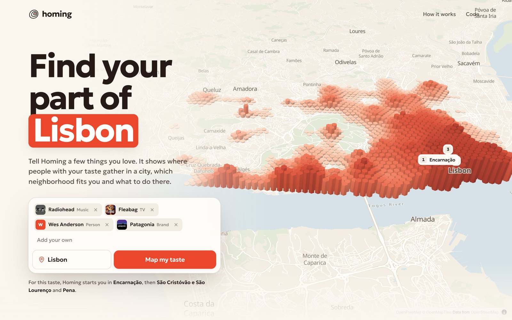
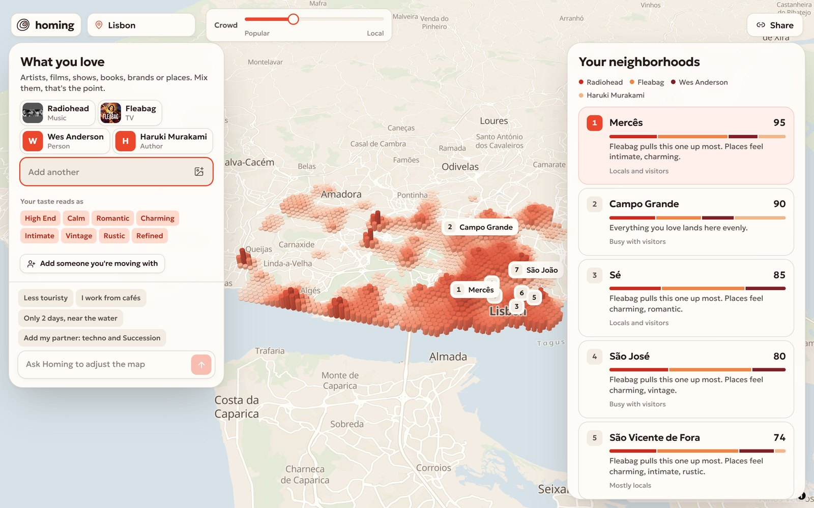
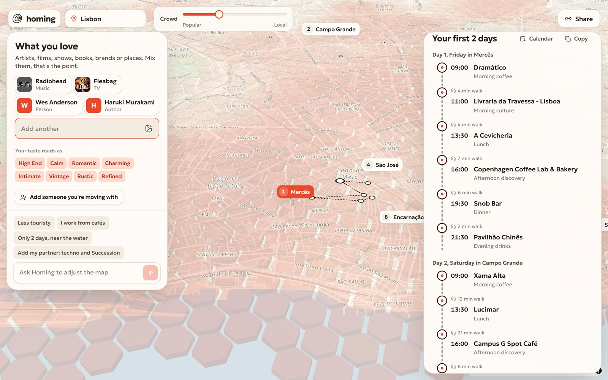
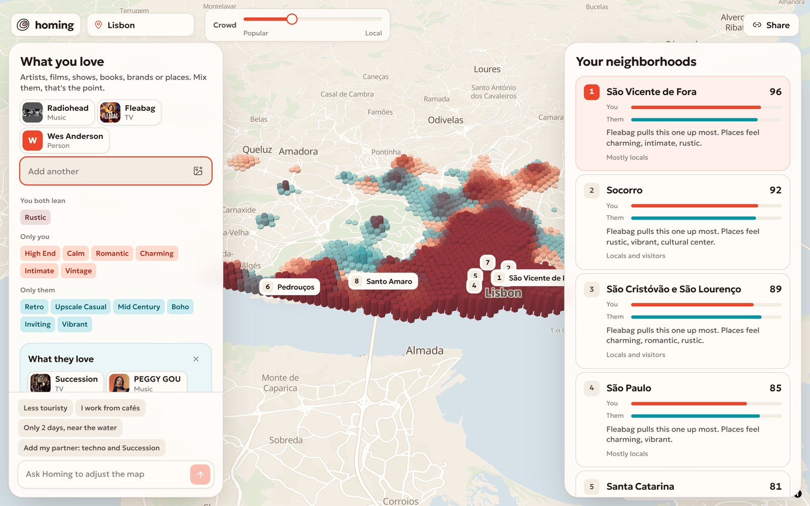
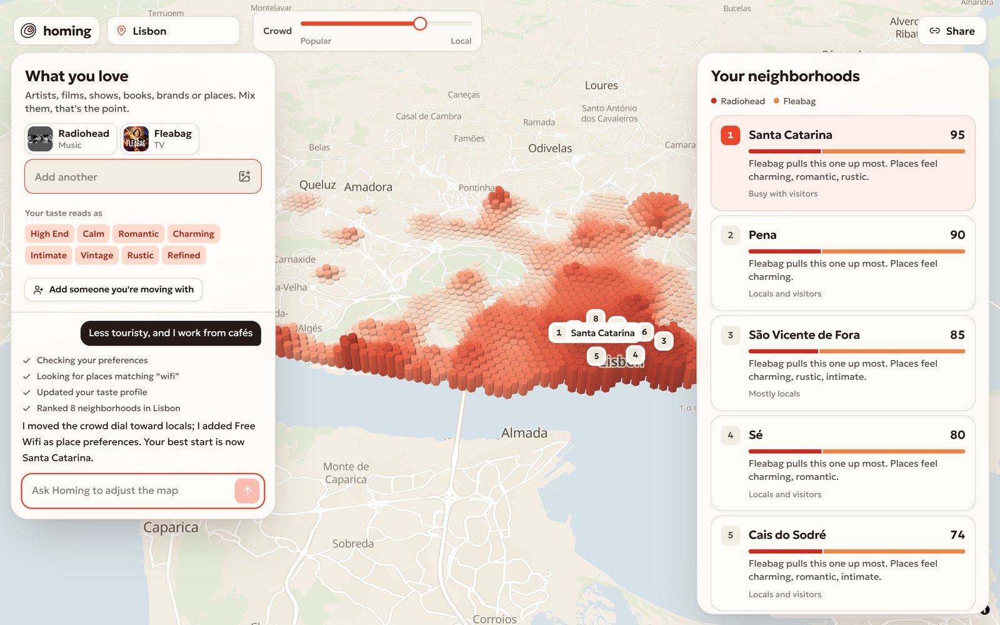

<p align="center">
  
</p>

<h1 align="center">Homing</h1>

<p align="center"><strong>Find your part of any city.</strong><br/>
Tell Homing a few things you love. It maps where people with your taste gather in a city, picks the neighborhood that fits you and plans your first days there.</p>

<p align="center">
  <a href="https://homing-taste.vercel.app"><strong>Try it live</strong></a> &nbsp;&nbsp;
  <a href="#how-it-works">How it works</a> &nbsp;&nbsp;
  <a href="#run-it-locally">Run it locally</a>
</p>



## The problem

When you move to a new city, or stay somewhere for a month, the neighborhood decides what your days feel like. You have to pick it before you know the city. Guides and chat assistants answer for an average visitor: the same five districts, described with the same stereotypes. Nobody can tell you where the people who love what *you* love actually spend their time.

## What Homing does

1. **You name what you love**, from any domain: artists, films, shows, books, brands, places. Type them, or drop a screenshot of a playlist, watchlist or bookshelf.
2. **The city turns into a taste terrain.** Columns rise where audiences with your taste over-index. Hover any column to see which of your loves drives it and whether it's busy with visitors or mostly locals.
3. **Neighborhoods are ranked with reasons:** which of your loves pulls each one up, and what its places feel like (cozy, vintage, live music).
4. **Open a neighborhood** to get cafés, food, bars, culture and stays that match you, each with the tags that make it a match.
5. **Plan my first days** builds a 1 to 3 day route around real opening hours and walking distance. Export it to your calendar or copy it.
6. **Talk to it.** "Less touristy." "I work from cafés." "Add my partner: Succession and Peggy Gou." The agent turns that into real changes on the map and tells you what changed.
7. **Moving with someone?** Add what they love. The map prints in two inks, and neighborhoods are ranked so the less happy person is as happy as possible.
8. **Share** the exact map with a link. Everything is in the URL, so it recomputes the same for whoever opens it.

| Your taste over Lisbon | A neighborhood, its places and your plan | Two people, two inks |
| --- | --- | --- |
|  |  |  |

**The agent at work.** "Less touristy, and I work from cafés" becomes a moved crowd dial and a free wifi requirement, the map re-forms, and every tool call shows up as it happens.

<p align="center"></p>

## Why it only works with Qloo

Take Qloo out and there is nothing left to show. Every step uses Qloo's taste graph:

| Step | Qloo call | What Homing does with it |
| --- | --- | --- |
| Understand the input | `GET /search` | Matches "Fleabag" to the show entity (not the book), with its audience. Ambiguous matches are offered as alternatives. |
| Taste field | `GET /v2/insights?filter.type=urn:heatmap` with `signal.interests.entities`, one call per love plus a combined one | Re-ranks cells inside the city, weighs each love by how much you care, mixes in refinement tags and applies the crowd dial using per-cell popularity. |
| Refinements | `GET /v2/tags`, then heatmaps with `signal.interests.tags` | "Cozy", "live music", "free wifi" become extra layers on the field. |
| Neighborhoods | `GET /v2/insights?filter.type=urn:entity:place` across the city | Names and centres of neighborhoods come from the places inside them; cells are assigned to them and scored. |
| Taste fingerprint | `GET /v2/insights?filter.type=urn:tag` with `filter.tag.types` for ambience, decor and place genres | Describes what you look for in a place, and explains neighborhoods and places through it. |
| Places | place insights with `filter.location=POINT(...)`, `radius` and category tags | Per-category picks that fit you, with opening hours, address and images. |
| Two people | everything above for both, plus shared and diverging tags | Fairness ranking: max of the minimum satisfaction. |

A language model alone can name famous districts. It cannot tell you that, for a person who loves Radiohead, Fleabag and Wes Anderson, the strongest concentration of similar people in Lisbon sits in one specific set of streets and not in the one every guide recommends. Homing can, because Qloo knows where those audiences are.

## How it works

```
 loves (text, chips, screenshot)
        │  Gemini 3.8 Flash extracts names        Qloo /search resolves entities
        ▼
 ExploreState  ──►  taste field  ──►  neighborhoods  ──►  places  ──►  plan
 (in the URL)      Qloo heatmaps     Qloo places +       Qloo places   opening hours +
                   per love,         assignment,         by category   walking distance
                   weights, dial     fingerprint tags
        ▲
        │  the agent edits the state through tools (search, tags, apply changes, get ranking)
 "less touristy, add my partner…"
```

**The field.** Qloo returns a metro-wide grid of geohash cells with an affinity per cell, the affinity of each domain, and popularity. Homing keeps the city, converts each series to a percentile inside it, combines your loves by weight, blends refinement layers, and applies the crowd dial:

$$ s = \frac{\sum_i w_i \, a_i}{\sum_i w_i}, \qquad s' = (1-r)\,s + r\,\overline{a_{tags}}, \qquad final = s' \cdot (1 - 0.7\, d\, p) $$

where $a_i$ is the percentile of love $i$ in the cell, $w_i$ your weight, $r = 0.35$, $d$ the crowd dial and $p$ the cell's popularity.

**The terrain.** Cells are interpolated onto a 130 m hex grid with inverse distance weighting and drawn as extruded columns in MapLibre. Two people are drawn with two inks that overprint where both are strong.

**Neighborhoods** get the mean of their top cells and the affinity of their places. With two people the ranking maximises $\min(you, them)$.

**The plan** fills morning coffee, culture, lunch, afternoon, dinner and drinks slots, scoring each candidate by affinity minus a walking penalty, skipping places that are closed at that hour, never repeating a place.

**The agent** runs on OpenRouter (`google/gemini-3.8-flash`) with tools that call the same engine. It never invents places: it can only change the state, look things up in Qloo and read the resulting ranking. Each tool call is streamed to the UI as it happens.

## Run it locally

```bash
git clone https://github.com/DarinaX2005X/qloo-hackathon.git
cd qloo-hackathon
npm install
cp .env.example .env.local   # add your keys
npm run dev
```

Open http://localhost:3000.

| Variable | What it is |
| --- | --- |
| `QLOO_API_KEY` | Qloo Taste AI key (hackathon server) |
| `QLOO_API_URL` | `https://hackathon.api.qloo.com` |
| `OPENROUTER_API_KEY` | OpenRouter key for the agent and screenshot reading |
| `LLM_MODEL` | `google/gemini-3.8-flash` |

`npm test` runs the engine, agent and state tests. Tests that call Qloo live run only with `QLOO_LIVE=1`.

## Stack

Next.js 16 (App Router), React 19, TypeScript, MapLibre GL with OpenFreeMap tiles, Motion, Zod, Vitest, Tailwind CSS 4. Deployed on Vercel. Qloo responses are cached server side and never stored in this repository.

## Limits

- Qloo's heatmap covers the wider metro area; Homing focuses on the city around its most popular places. Small towns can have thin data, and Homing says so.
- Some domains, like video games, have no geographic signal. They still shape your taste fingerprint and place picks.
- Opening hours come from Qloo and can be missing for some places; the plan marks those.

## License

[MIT](LICENSE)
